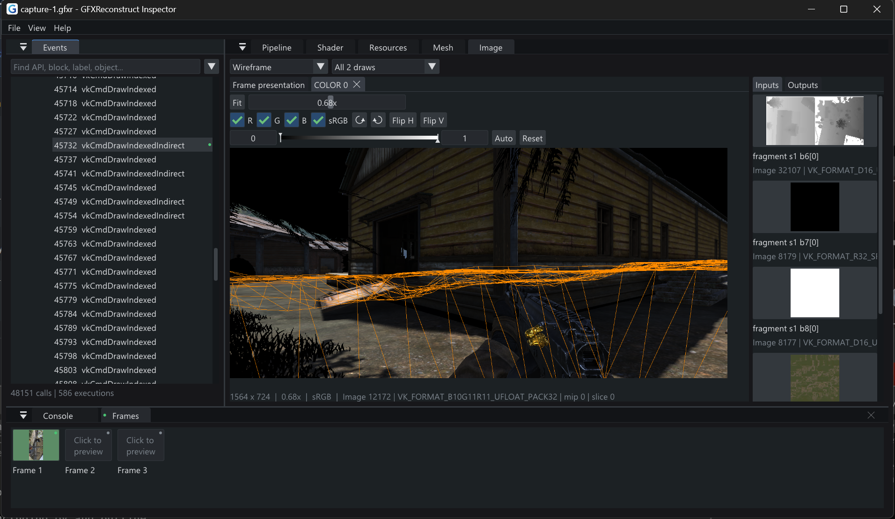

# GFXReconstruct Inspector

A Vulkan capture inspector for Windows and macOS, with a desktop GUI and a JSON CLI. Inspect draws,
images, buffers and meshes; edit shaders and verify changes by replay.



## Start

Extract the release for your platform:

| Platform | Launch | Settings, sessions and caches |
| --- | --- | --- |
| Windows x64 | Run `gfxrecon-gui.exe` | Beside the executable; keep the folder writable |
| macOS | Open `gfxrecon-gui.app` | `~/Library/Application Support/GFXReconstruct Inspector` |

The GUI and CLI share these locations. Use `--settings-dir DIR` to choose another
location. macOS test packages are ad-hoc signed and not notarized.

1. Open **File > Samples > Indexed cube (mesh)**.
2. Select a submitted draw in **Events**.
3. Use **Image** for attachments, **Mesh** for geometry, and **Pipeline** for bindings.
4. Open a shader, enable **Edit**, then **Compile** and **Apply**.
5. **Reset shader** restores the captured shader and replays automatically.

The bundled triangle, cube and indirect-triangle captures work without a phone.
Android replay needs a compatible, authorized, unlocked device and the replay APK.

On macOS, local GPU replay needs a Vulkan runtime. Install the
[LunarG Vulkan SDK for macOS](https://vulkan.lunarg.com/sdk/home#mac), then
[configure the loader, MoltenVK and host tools](docs/BUILD.md#macos).
The GUI itself and offline inspection do not require the local Vulkan runtime.

Android capture/replay needs [SDK Platform-Tools (adb)](https://developer.android.com/tools/releases/platform-tools)
and our compatible debug replay/layer APK; capture targets must be debuggable
Vulkan apps. NDK, JDK and the remaining Android build tools are needed only when
building those APKs.
See [Android prerequisites](docs/BUILD.md#android-device-capture-and-replay).

## CLI

Run from the extracted release folder. On Windows (PowerShell):

```powershell
.\gfxrecon-cli.exe --help
.\gfxrecon-cli.exe dump --capture samples/indexed-cube.gfxr --out decoded
.\gfxrecon-cli.exe replay draw --capture samples/indexed-cube.gfxr --execution 0 --full
```

On macOS (Terminal), samples are inside the app bundle:

```sh
sample_capture="gfxrecon-gui.app/Contents/Resources/samples/indexed-cube.gfxr"
./gfxrecon-cli --help
./gfxrecon-cli dump --capture "$sample_capture" --out decoded
./gfxrecon-cli replay draw --capture "$sample_capture" --execution 0 --full
```

Local replay on macOS uses the [SDK environment](docs/BUILD.md#macos) described
in the build guide; static dumps do not need a local Vulkan runtime.

Commands return JSON; help is plain text. Use `describe` for the machine-readable
command schema, or `<command> --help` for command options.

## Guides

- [GUI: capture, inspect and edit](docs/GUI.md)
- [CLI: decode, search, replay and probe](docs/CLI.md)
- [Build, test and package](docs/BUILD.md)

The GUI and CLI share capture/replay services and caches. Original captures are
preserved; shader replacements and replay outputs are separate artifacts.

## Build

Initialize dependencies on either platform:

```sh
git submodule update --init --recursive
```

Configure with the native toolchain:

| Platform | Prerequisites | Configure |
| --- | --- | --- |
| Windows x64 | Visual Studio 2022 C++ tools and Windows SDK | `cmake -S . -B build -A x64` |
| macOS | Xcode Command Line Tools and Ninja | `cmake -S . -B build -G Ninja -DCMAKE_BUILD_TYPE=Release` |

Build and test on either platform (CMake 3.24+):

```sh
cmake --build build --config Release --parallel 8
ctest --test-dir build -C Release --output-on-failure
```

See the [build guide](docs/BUILD.md) for executable locations, replay tools,
Android prerequisites, and app/CLI ZIP packaging for Windows and macOS.
Licensed under [MIT](LICENSE). Third-party components retain their own licenses;
see [licenses](licenses).
