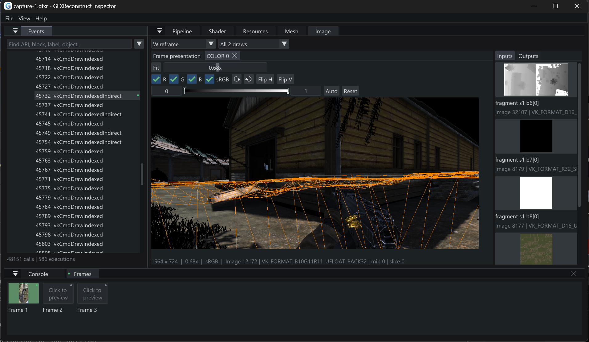

# GFXReconstruct Inspector

[](LICENSE)


A Vulkan capture inspector for Windows and macOS, with a desktop GUI and a JSON CLI. Inspect draws,
images, buffers and meshes; edit shaders and verify changes by replay.



## Why use this for Android instead of RenderDoc?

This project favors independent replay jobs and durable results for Android
Vulkan investigations, especially when driven by scripts or agents. Each replay
starts the backend, loads the capture, produces the requested outputs, and exits.
Saved indexes, pipeline state, shaders and readbacks can then be queried without
keeping a device replay context alive.

The motivation is practical: in our Android workflow, RenderDoc remote sessions
have sometimes dropped and required reconnecting and reopening the capture.
Independent jobs reduce that dependence on a long-lived session: retry the
failed job while keeping completed results available on disk. ADB and a ready
device are needed when running a device job; offline inspection can continue
afterward.

| Trade-off | GFXReconstruct Inspector | RenderDoc remote replay |
| --- | --- | --- |
| Replay lifetime | Fresh backend process for each job | An open capture and replay controller serve interactive requests |
| Recovery | Retry a job; completed outputs remain usable | A lost remote context can require reconnecting and reopening the capture |
| Repeated inspection | More startup and capture-loading work; often slower | Keeps the capture loaded and amortizes setup across requests |
| Script and agent interface | Packaged JSON CLI over the same core as the GUI | CLI commands and scripting APIs are available; custom analysis needs its own automation layer |

Our CLI needs neither an open inspector GUI nor an MCP bridge. RenderDoc
automation is possible too: it provides `renderdoccmd` and
[standalone Python scripting](https://github.com/baldurk/renderdoc/blob/v1.x/docs/python_api/python_module.rst).
Its standalone Python bindings are native modules (`.pyd` on Windows, `.so` on
Linux) tied to a Python major/minor version and RenderDoc's core library; using a
different interpreter can require a matching build. Packaging those bindings and
managing the [remote replay context](https://github.com/baldurk/renderdoc/blob/v1.x/docs/how/how_network_capture_replay.rst)
adds integration work compared with invoking our ready-to-use JSON commands.
GUI-attached MCP integrations also inherit the GUI's open-capture and connection
state; that requirement belongs to those integrations, not every RenderDoc API.

Both our Windows and macOS GUI/CLI can drive replay on an Android phone through
ADB. GPU execution happens on the phone, so Android device replay does not need
a Vulkan runtime on the host Mac. See the
[Android prerequisites](docs/BUILD.md#android-device-capture-and-replay).

## Start

Extract the release for your platform:

| Platform | Launch | Settings, sessions and caches |
| --- | --- | --- |
| Windows x64 | Run `gfxrecon-gui.exe` | Beside the executable; keep the folder writable |
| macOS | Open `gfxrecon-gui.app` | `~/Library/Application Support/GFXReconstruct Inspector` |

The GUI and CLI share these locations. Use `--settings-dir DIR` to choose another
location. macOS test packages are ad-hoc signed and not notarized.

1. Open **File > Samples > Indexed cube (mesh)**.
2. Select a submitted draw in **Events**.
3. Use **Image** for attachments, **Mesh** for geometry, and **Pipeline** for bindings.
4. Open a shader, enable **Edit**, then **Compile** and **Apply**.
5. **Reset shader** restores the captured shader and replays automatically.

The bundled triangle, cube and indirect-triangle captures work without a phone.
Android replay needs a compatible, authorized, unlocked device and the replay APK.

On macOS, local GPU replay needs a Vulkan runtime. Install the
[LunarG Vulkan SDK for macOS](https://vulkan.lunarg.com/sdk/home#mac), then
[configure the loader, MoltenVK and host tools](docs/BUILD.md#macos).
The GUI itself and offline inspection do not require the local Vulkan runtime.

Android capture/replay needs [SDK Platform-Tools (adb)](https://developer.android.com/tools/releases/platform-tools)
and our compatible debug replay/layer APK; capture targets must be debuggable
Vulkan apps. NDK, JDK and the remaining Android build tools are needed only when
building those APKs. Install the replay APK through **Settings > Tools and devices >
Capture environment > Install replay APK** before capturing; it supplies the capture layer.
On Android 11+, this button also handles package visibility with
`--force-queryable`, usually avoiding target APK manifest changes. The inspector
enables the layer before restarting the target and writes captures to app-private
storage, so the target needs no embedded capture SDK or extra storage permissions.
See [Android capture setup and troubleshooting](docs/BUILD.md#android-capture-setup)
for the manual install command and common failures.

For capture, open **File > Capture application**. The first ready connected phone
is selected automatically; choose the app and click **Launch**, then **Capture**
when the scene is ready. Missing prerequisites open setup guidance. Unavailable
actions stay visible and gray; hover for details. Recording mode and arguments
are shown inline. **End session** finishes any recording and asks whether to close
the app; the title-bar X only hides the controls. Advanced manual start/stop
controls are available through the [CLI](docs/CLI.md#capture).

## CLI

Run from the extracted release folder. On Windows (PowerShell):

```powershell
.\gfxrecon-cli.exe --help
.\gfxrecon-cli.exe dump --capture samples/indexed-cube.gfxr --out decoded
.\gfxrecon-cli.exe replay draw --capture samples/indexed-cube.gfxr --execution 0 --full
```

On macOS (Terminal), samples are inside the app bundle:

```sh
sample_capture="gfxrecon-gui.app/Contents/Resources/samples/indexed-cube.gfxr"
./gfxrecon-cli --help
./gfxrecon-cli dump --capture "$sample_capture" --out decoded
./gfxrecon-cli replay draw --capture "$sample_capture" --execution 0 --full
```

Local replay on macOS uses the [SDK environment](docs/BUILD.md#macos) described
in the build guide; static dumps do not need a local Vulkan runtime.

Commands return JSON; help is plain text. Use `describe` for the machine-readable
command schema, or `<command> --help` for command options.

## Guides

- [GUI: capture, inspect and edit](docs/GUI.md)
- [CLI: decode, search, replay and probe](docs/CLI.md)
- [Build, test and package](docs/BUILD.md)

The GUI and CLI share capture/replay services and caches. Original captures are
preserved; shader replacements and replay outputs are separate artifacts.

## Build

Initialize dependencies on either platform:

```sh
git submodule update --init --recursive
```

Configure with the native toolchain:

| Platform | Prerequisites | Configure |
| --- | --- | --- |
| Windows x64 | Visual Studio 2022 C++ tools and Windows SDK | `cmake -S . -B build -A x64` |
| macOS | Xcode Command Line Tools and Ninja | `cmake -S . -B build -G Ninja -DCMAKE_BUILD_TYPE=Release` |

Build and test on either platform (CMake 3.24+):

```sh
cmake --build build --config Release --parallel 8
ctest --test-dir build -C Release --output-on-failure
```

See the [build guide](docs/BUILD.md) for executable locations, replay tools,
Android prerequisites, and app/CLI ZIP packaging for Windows and macOS.
Licensed under [MIT](LICENSE). Third-party components retain their own licenses;
see [licenses](licenses).
